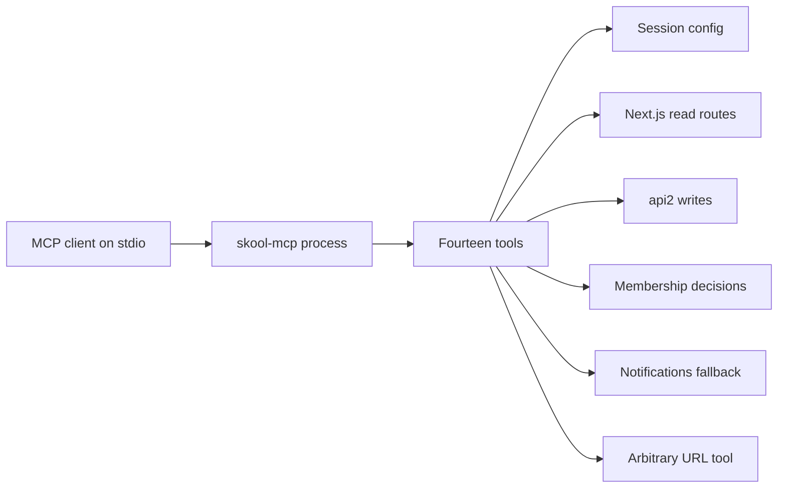

# Skool MCP

An MCP client starts this process over stdio. The process registers fourteen tools. Each tool reads a cookie string from a config file on the machine, then calls Skool over HTTPS. A box with a + is one of the harder paths.

These boxes are parts that exist together. They are not steps in one state machine. The process does not store community data of its own. It returns text from the upstream response, or it throws.

## What the process registers

`src/index.ts` builds an MCP server named `skool-mcp` at version `0.1.0`, connects a stdio transport, and registers every tool the same way: the tool name, description, and schema object go to the SDK, and the handler's string is wrapped as one text content block. This file does not catch handler errors. How the SDK shows a thrown error to the client was not verified, because this checkout has no installed SDK to read.

The registered names, in source order:

- `skool_request` sends any URL the caller names, with the cookie string attached.
- `skool_community_info` and `skool_community_labels` read one community.
- `skool_members_list`, `skool_members_pending`, `skool_members_approve`, and `skool_members_reject` cover the member list and a membership decision.
- `skool_posts_list`, `skool_posts_get`, `skool_posts_create`, and `skool_posts_comment` cover the feed and two writes.
- `skool_courses_list` and `skool_lessons_list` cover the classroom.
- `skool_notifications` tries a data route, then an HTML page.

Reads that need a community slug use the argument slug, or `defaultCommunity` from config. If both are empty, those handlers throw before any HTTP call. Writes that take a group id do not look up that id themselves.

## Two upstreams, plus one open fetch

Read tools call `https://www.skool.com` (or `baseUrl` from config) at `/_next/data/{buildId}/...json`. The build id comes from the homepage HTML and is remembered in this process for 30 minutes. See [Next.js read routes](next-data-read.md).

`skool_community_labels`, `skool_posts_create`, `skool_posts_comment`, and `skool_courses_list` when a group id is passed call `https://api2.skool.com`. That host is fixed in code. It does not follow `baseUrl`. See [api2 writes](api2-write.md).

`skool_members_approve` and `skool_members_reject` POST to guessed `api2` paths through the raw fetch, which returns the status instead of throwing on its own. See [Membership decisions](membership-decision.md).

`skool_notifications` is the only tool that catches a failed data route and tries a second page. See [Notifications fallback](notifications-fallback.md).

`skool_request` is the escape hatch. It fetches the URL it is given. Cookies and a browser User-Agent are added first, then any caller headers are copied on top, so a caller header can replace the cookie. HTTP error statuses are returned as text, not thrown. The tool description says the URL is a Skool URL. The code does not check the host.

Every client function sends the same Chrome 131 User-Agent string and the cookie header as the raw `cookies` string from config. An empty cookie string is still sent. Nothing in this repo refreshes, parses, or expires that string.

## Names in older docs

`README.md` and `SPEC.md` spell tool names with dots (`skool.request`, `skool.posts.list`). The registered names use underscores. `SPEC.md` also describes `skool.discover`, a `communitySlug` field, rate-limit delays, and HTML parsing with cheerio. None of those are in `src/`. The config field the code reads is `defaultCommunity`.

## What this map does not verify

No test file is in this repo, and this map did not call Skool. Response shapes in `API-DISCOVERY.md`, the README claim that the auth cookie lasts about a year, and the README claim that CloudFront returns 403 without a User-Agent are upstream notes. The code only reacts to HTTP status and to whether a body parses. Those upstream notes are unverified here.

`SPEC.md` says the server should return clear errors when auth fails. The code has no branch that recognizes an auth failure. A 401 or 403 is the same as any other non-ok status on the helpers that throw, and it is just another status line on the helpers that do not.
