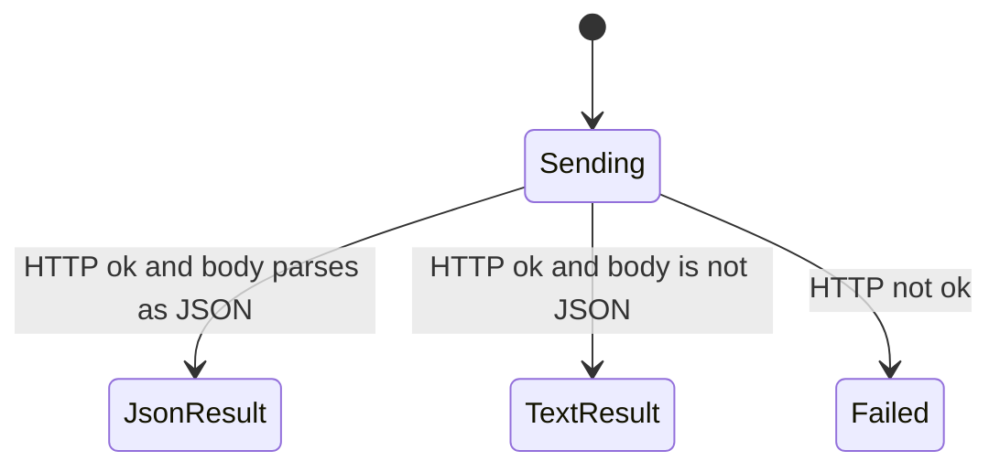

# api2 writes

Some tools call `https://api2.skool.com` instead of a Next.js data URL. The host is fixed. Config `baseUrl` is not used. Config is still loaded first, because the cookie string has to be attached. If that load throws, the request is never sent. This chart starts once the helper is sending.

Whether these paths and bodies match the live Skool API is unverified. The map only records what this repo sends and how it treats the reply.

The helper always reads the whole body as text first. It does not try a second path of its own. It does not retry.

## Ok JSON comes back

Headers on every call are the User-Agent, the cookie string, `Accept: application/json`, `Origin: https://www.skool.com`, and `Referer: https://www.skool.com/`. When the tool passes a body, the helper also sets `Content-Type: application/json` and sends `JSON.stringify` of that body. A GET with no body does not set a content type.

If the status is ok and the text parses as JSON, the parsed value is returned. The tool then pretty-prints it. Creating a post and adding a comment both do that. They do not inspect the parsed fields.

The calls are:

- Category labels: `GET /groups/{groupId}/labels`.
- Courses, only when `groupId` is a non-empty string: `GET /groups/{groupId}/courses`. A community slug passed with that group id is ignored.
- New post: `POST /posts?notify=false&follow=true`. The JSON body is `post_type` `"generic"`, `group_id`, and `metadata`. Metadata always has `action` `0`, `content`, and `title`. A category is added as `metadata.labels` set to that one string, not as a list.
- New comment: `POST /comments`. The JSON body is `post_id`, `group_id`, and `metadata.content`.

## Ok text that is not JSON

If the status is ok and the body is not JSON, the helper returns the raw text. The tool still runs that text through `JSON.stringify`, which wraps it in quotes. The caller sees a JSON string, not the original text.

## The status was not ok

Any status outside the ok range throws. The message includes the status, the status text, and up to 500 characters of the body. There is no separate branch for 401, 403, or 404. The post or comment tool does not record a local copy, so a throw leaves this process with nothing saved.

A network failure rejects before this chart reaches Failed. The helper does not convert that into the status error.
