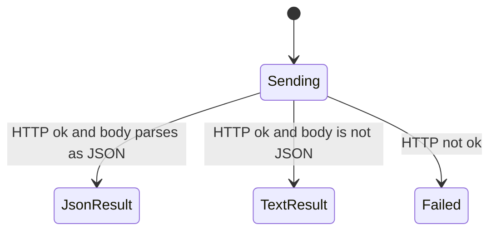

# api2 writes

Some tools call `https://api2.skool.com` instead of a Next.js data URL. The host is fixed. Config `baseUrl` is not used. Config is still loaded first, because the cookie string has to be attached. If that load throws, the request is never sent. This chart starts once the helper is sending.

Whether these paths and bodies match the live Skool API is partly verified. The comment shape below matches a comment created live on 2026-10-26 and the shapes existing live comments carry. The video shapes below match Skool's web client (`createPost` sends `metadata.video_ids`/`metadata.video_links`; `createMuxVideo` posts to `/videos`) and, for `videoLinks`, a live feed post read back read-only. Image and video uploads were not run live; they are covered by mocked-HTTP tests in `tests/posts.test.ts`.

The helper always reads the whole body as text first. It does not try a second path of its own. It does not retry.

## Ok JSON comes back

Headers on every call are the User-Agent, the cookie string, `Accept: application/json`, `Origin: https://www.skool.com`, and `Referer: https://www.skool.com/`. When the tool passes a body, the helper also sets `Content-Type: application/json` and sends `JSON.stringify` of that body. A GET with no body does not set a content type.

If the status is ok and the text parses as JSON, the parsed value is returned. Creating a post without images and adding a comment pretty-print it. Creating a post with images wraps the post result with `imageStatuses`, one entry per image containing its file id, path, and status.

The calls are:

- Category labels: `GET /groups/{groupId}/labels`.
- Courses, only when `groupId` is a non-empty string: `GET /groups/{groupId}/courses`. A community slug passed with that group id is ignored.
- New post: `POST /posts?notify=false&follow=true`. The JSON body is `post_type` `"generic"`, `group_id`, and `metadata`. Metadata always has `action` `0`, `content`, `title`, and `video_ids` (comma-joined uploaded video ids, `""` when none). A category is added as `metadata.labels` set to that one string, not as a list. File attachments are added as `metadata.attachments`, comma-joined file ids. With `images`, every local file is checked for a supported extension, readability, and non-empty size before any upload. Each image is then registered with `POST /files` (`file_name`, `content_type`, `content_length`, `content_disposition` `""`, `ref` `""`, `owner_id` the group id, `large_thumbnail` false), and streamed by PUT to the returned `write_url` with the returned `acl` as `x-amz-acl` and no cookie. The optional `GET /files?ids=` status check polls up to 15 times, about once a second, for `postprocessed_at` and `metadata.read_url`. Each image is reported as `processed` when both fields appear, `stillProcessing` when the file is returned but not ready after 15 successful checks, or `statusUnknown` when the status check errors, times out, or returns no file. Status check outcomes do not prevent post creation. Uploaded file ids are appended to `attachments` after any `attachmentIds`. When `images` is passed, the combined count of images and `attachmentIds` is capped at 10; without `images`, `attachmentIds` have no new cap. Video checks also run before any upload. External videos are added as `metadata.video_links`, newline-joined URLs; only YouTube, Vimeo, Loom, and Wistia hosts are accepted, and uploaded plus linked videos together are capped at 10. Invalid links and over-cap counts throw before any request.
- New comment: plain `POST /posts` with no query (the former `POST /comments` returns 404). The JSON body is `post_type` `"comment"`, `group_id`, `parent_id` and `root_id` both set to the parent post id, and `metadata` with `action` `0`, `content`, and `video_ids` as above. `video_links` is added the same way as for a post.
- Video upload: `POST /videos` with `group_id`, `file_name`, `content_type`, `content_length`, and `reference_type` (`"post"` or `"comment"`). The response's video id and upload URL (camelCase or snake_case keys are both accepted) are read, then the file is streamed from disk (never buffered whole, and opened before the API call) via PUT to that upload URL with Content-Length and no cookie header. Files that are empty, not a recognised video type, or at or over 30GB (32212254720 bytes, the web client's post limit) throw before any request. Processing after upload is Skool-side; the tool returns the video id without waiting for it.

## Ok text that is not JSON

If the status is ok and the body is not JSON, the helper returns the raw text. Without images, the post tool runs that text through `JSON.stringify`, which wraps it in quotes. With images, the raw text appears in the `post` field alongside `imageStatuses`.

## The status was not ok

Any status outside the ok range throws. The message includes the status, the status text, and up to 500 characters of the body. There is no separate branch for 401, 403, or 404. The optional image status check catches that error and reports `statusUnknown`; errors from upload or post creation still propagate. The post or comment tool does not record a local copy, so a propagated error leaves this process with nothing saved.

A network failure rejects before this chart reaches Failed. The helper does not convert that into the status error.
