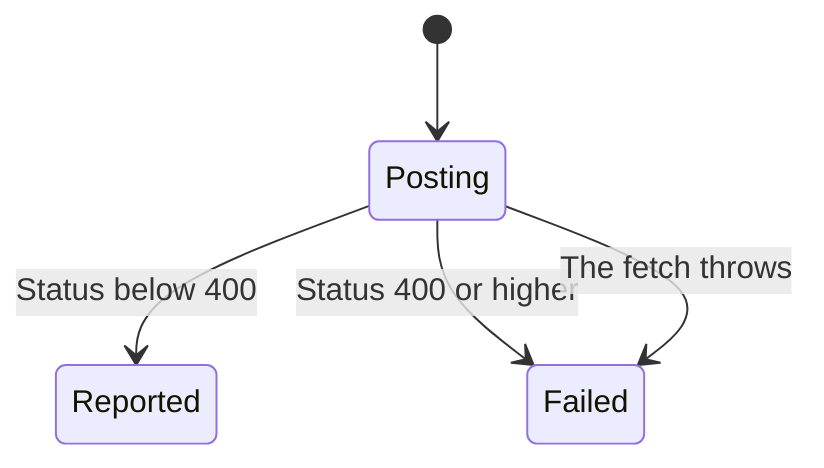

# Membership decisions

Listing members is a normal Next.js read. Approving or rejecting is not. Both tools POST to a URL built in this file. The approve handler's comment calls that URL the most likely pattern and tells the caller to use the request tool to discover the exact endpoint. Reject uses the same shape with `/reject` and has no separate comment. The local POST is implemented. Whether Skool exposes those paths was not verified, so this page is mixed.

The chart is only the approve or reject POST. The pending list is a separate read, described below.

## Who can be listed

`skool_members_list` GETs `/{slug}/-/members` through the Next.js helper with `group` and a page number. `skool_members_pending` GETs the same path with `group` and `tab=pending`, and it does not send a page. Both throw when `pageProps` is missing or falsy, and both return that object as pretty JSON. The description says pending requires admin or moderator cookies. The code does not check a role. It sends the same cookie string as every other tool.

The slug rule is the same as the other reads: argument, then `defaultCommunity`, then a throw if both are empty.

## Status below 400

Approve POSTs `https://api2.skool.com/groups/{groupId}/members/{memberId}/approve` with no body. Reject POSTs the same shape with `/reject` at the end. Both go through the raw fetch, so a non-ok HTTP status is still a returned result at the fetch layer. The tool then treats a status of 400 or higher as failure. Below 400, the tool returns a sentence that the member was approved or rejected, plus the status and the raw body. It does not parse the body, and it does not check that the body says the decision happened.

The raw fetch still attaches the User-Agent, the cookie string, and `Accept: application/json`. No extra headers are passed by these two tools, so those three are not overridden here. The group id and member id are interpolated into the path with no encoding step in this file.

## Approve or reject failed

A status of 400 or higher throws. The message says approve failed or reject failed, includes the status, and includes up to 500 characters of the body. If the fetch itself throws, that error propagates. The tool has no second URL to try.

A status below 400 is reported as success even when the body is an error page or empty. That cutoff is the only success test in this file.

## Why this is mixed

The list and pending reads are ordinary calls through the shared Next.js helper. Their remote payload shape is unverified, same as the other reads. The approve and reject URLs are a stronger gap: the approve comment says to discover the exact endpoint and calls the string the most likely pattern. This map did not send those POSTs. Do not treat a status below 400 from this chart as proof that Skool changed a membership.
