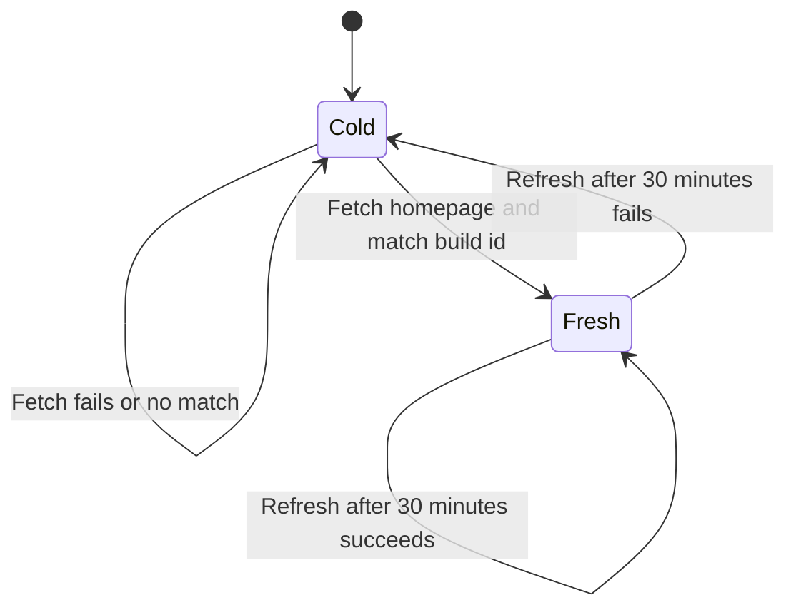
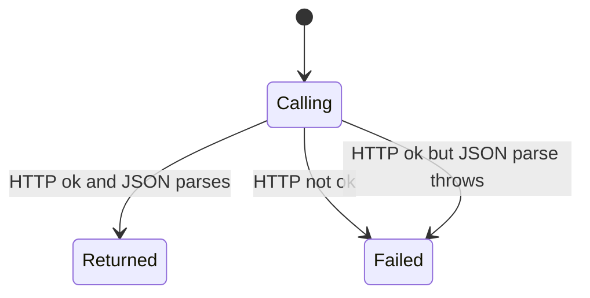

# Next.js read routes

Several tools read Skool by calling a Next.js data URL. That URL includes a build id taken from the homepage HTML. The id is cached in this process for 30 minutes. The chart below is only that cache. Whether today's Skool homepage still contains a `buildId` field is unverified, because this map did not fetch the site.

A read that already has an id then makes one GET. Tools other than notifications do not catch the failure. They throw, and the MCP handler in `src/index.ts` does not catch it either.

## No usable build id

Cold means the next call must hit the network. That is true on startup, and again once the saved id is 30 minutes old. An expired id is left in memory but is not returned. The age check uses `Date.now()` minus the time the id was stored. The limit is 30 minutes.

The homepage request is `GET` on `baseUrl` from config, with the User-Agent and the cookie string. The response body is searched with a regular expression for `"buildId"` followed by a JSON string. The first match is stored.

## Homepage did not yield an id

A homepage status that is not ok throws, and the message includes the status code. A body with no match throws that the build id could not be extracted. Neither failure clears an older cached object, and neither failure returns that older id once it is past 30 minutes. The next call tries the homepage again.

There is no path that deletes the cache when a later data URL returns 404. A deploy that changes the build id inside the 30 minute window keeps sending the old id until the window ends.

## Build id is fresh

Within 30 minutes, `getBuildId` returns the saved string and does not request the homepage. Every Next.js read in that window shares that one id, across communities and tools.

## A stale id is not reused

On the first call after 30 minutes, the function tries the homepage again before returning. If that attempt throws, the caller gets the error. The old string is not used as a fallback.

## The data route returned JSON

With an id in hand, the URL is `baseUrl` plus `/_next/data/{buildId}{path}.json`, plus the query string the tool built. The request sends the User-Agent, the cookie string, and `Accept: application/json`. An ok response is parsed as JSON and returned to the tool.

The tools that use this helper, and the path they pass:

- Community info uses `/{slug}/about` with query `group` set to the slug.
- The post list uses `/{slug}` with `group`, `p` for the page number, `s` for the sort, and `c` for a category only when a category was passed.
- One post uses `/{slug}/{postSlug}` with `group` and `p` set to the post slug. On the list, `p` is a page number. On this call, `p` is the slug.
- The member list uses `/{slug}/-/members` with `group` and `p` for the page.
- Pending members use the same members path with `group` and `tab=pending`, and no page argument.
- Courses without a group id use `/{slug}/classroom` with `group`.
- Lessons use `/{slug}/classroom/{courseSlug}` with `group` and `course`.
- Notifications tries `/notifications` with `p` for the page. Its failure path is a different page.

Each of those handlers then requires `pageProps` on the parsed object. If it is missing, the handler throws. The returned text is `pageProps` pretty-printed. The rest of the Next.js payload is dropped. What Skool puts inside `pageProps` is unverified here.

The slug is the tool argument when present, otherwise `defaultCommunity`. An empty slug throws before `getBuildId` runs. `skool_posts_list` always sends `page` and `sort` through. The schema defaults are page `1` and sort `newest-cm`. Whether the SDK applies those defaults before the handler runs was not verified.

## The data route failed

A non-ok status throws. The message includes the status, the status text, and up to 500 characters of the body. A body that is not JSON throws from the JSON parse after the status check. The build id cache is left as it was.

Notifications is the one caller that catches either throw and tries an HTML page. The other callers surface the throw.
