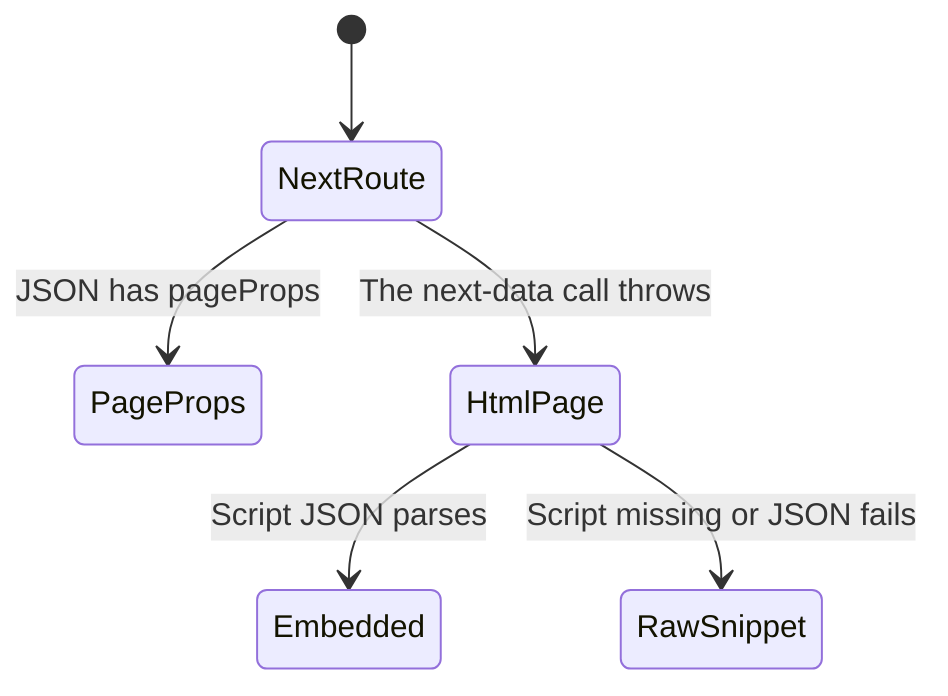

# Notifications fallback

This tool tries two ways to read notifications. The first is the shared Next.js data helper. If that throws, the tool fetches an HTML page and looks for an embedded JSON script. The source comment says the data route is the likely place. Both attempts are implemented in this file. Which one the live site actually serves is unverified.

Config is loaded before the chart starts. A missing config file throws there and does not reach the HTML fallback. The chart is what happens after config is already cached.

The only argument is a page number. The schema default is `1`. Whether the SDK fills that default was not verified. The number is sent as `p` on both attempts.

## The data route had page props

The data path is `/notifications` on `baseUrl`, with query `p` set to the page. This uses the same build id cache as every other Next.js read. If the parsed JSON has `pageProps`, the tool returns that object pretty-printed and stops. It does not look at the HTML page.

## The data route threw

The catch has no filter. A build id failure, a non-ok data URL, a body that is not JSON, and a missing `pageProps` all take the same path. The error text is discarded. The tool does not tell the caller that the first attempt failed.

## The HTML held Next data

The fallback URL is `baseUrl` plus `/notifications?p=` plus the page number, fetched with the raw helper. The raw helper returns the status and the full body even when the status is not ok. The tool then searches the body for a script tag whose id is `__NEXT_DATA__`, parses the tag's text as JSON, and returns `props.pageProps` when that object exists. If `props.pageProps` is missing, it returns the whole parsed object instead. The HTTP status is not included in that success text.

## The HTML had no usable payload

If the script tag is missing, or the tag text is not JSON, the tool returns the HTTP status and the first 3000 characters of the body. This branch does not throw. A 403 page, a login page, and a short HTML document all come back as that text. The caller cannot tell this case apart from a successful read except by reading the text.
