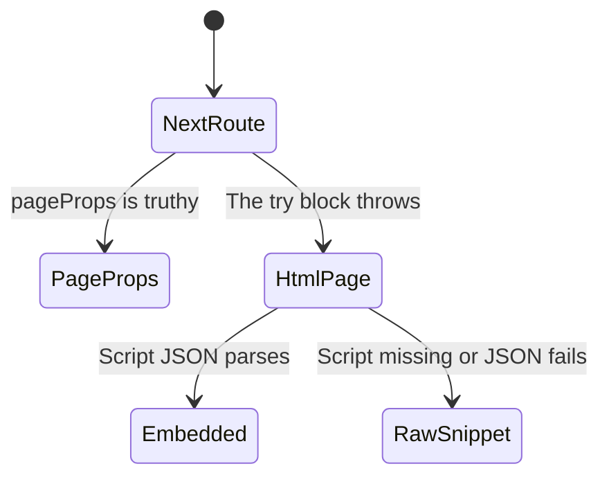

# Notifications fallback

This tool tries two ways to read notifications. The first calls the shared Next.js data helper. If that call throws, or the JSON has no usable `pageProps`, the handler fetches an HTML page and looks for an embedded script. A comment in the tool says notifications are likely at a user-level route. The two attempts are written in this handler. Which response the live site actually returns is unverified.

Config is loaded before the chart starts. A missing config file throws there and does not reach the HTML fallback. The chart is what happens after config is already cached.

The only argument is a page number. The schema default is `1`. Whether the SDK fills that default was not verified. The number is sent as `p` on both attempts.

## The data route had page props

The handler passes the path `/notifications` and query `p` set to the page. The shared helper turns that into `baseUrl` plus `/_next/data/{buildId}/notifications.json`. This uses the same build id cache as every other Next.js read. If `pageProps` is truthy, the tool returns that object pretty-printed and stops. It does not look at the HTML page. A missing or falsy `pageProps` throws and does not stay in this state.

## The data route threw

The catch has no filter. A build id failure, a non-ok data URL, a body that is not JSON, and a missing or falsy `pageProps` all take the same path. The error text is discarded. The tool does not tell the caller that the first attempt failed.

## The HTML held Next data

The fallback URL is `baseUrl` plus `/notifications?p=` plus the page number, fetched with the raw helper. The raw helper returns the status and the full body even when the status is not ok. The tool searches the body for a script tag that starts with `<script id="__NEXT_DATA__"`. The id has to be the first attribute, in double quotes. A later `id` attribute does not match. It parses the tag text as JSON and returns `props.pageProps` when that value is not null or undefined. Otherwise it returns the whole parsed value. The HTTP status is not included in that success text. If the raw fetch throws, that error leaves the handler. The chart does not turn it into a snippet.

## The HTML had no usable payload

If the script tag is missing, or the tag text is not JSON, the tool returns the HTTP status and the first 3000 characters of the body. This branch does not throw. The code does not special-case a 403, a login page, or a short document. If the script is missing they come back as that text. What those live pages contain is unverified. The caller cannot tell this case apart from a successful read except by reading the text.
