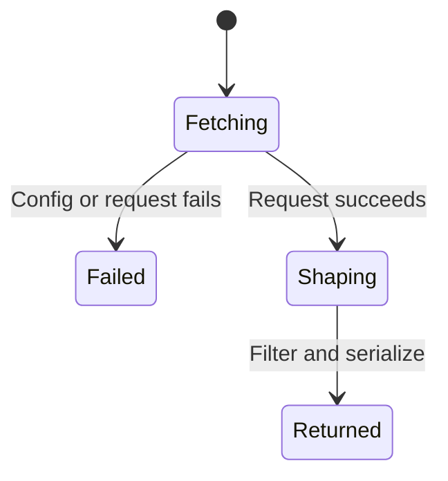

# Notifications

`skool_notifications` uses `GET https://api2.skool.com/self/notifications?type=all`, adding `cursor` when supplied. It never marks notifications read. There is no Next.js or HTML fallback. Configuration, network, and non-ok HTTP errors propagate through the shared [api2 helper](api2-write.md). Config `baseUrl` resolves notification links; it does not select the API host.

The handler reads `messages`, parses each record's `metadata.data` as JSON (using an empty object on parse failure), and returns `notifications`, `has_more`, and `next_cursor`. Each notification includes its id, category, action, unread flag, timestamp, absolute link or null, actor, text, content, post identifiers, and group identifiers. Missing optional values are null, except `created_at`, which is omitted when absent.

Category matching is ordered: actions starting with `mention` become `mention`; containing `reply` become `reply`; starting with `comment` become `comment`; containing `member` or `join` become `new_member`; starting with `upvote` or containing `like` become `like`; exactly `new-post` becomes `new_post`; everything else becomes `other`.

Optional `categories` and `unread_only` filters apply after fetching one upstream page. An empty category list applies no category filter. Filtering does not change upstream pagination: an empty result can still have `has_more=true`. When `has_more` is false, `next_cursor` is null; otherwise it uses the upstream cursor (omitted if the upstream supplies none). Pass that cursor on the next call. The former `page` argument is no longer supported. Live upstream payload shapes have not been verified by this document.
