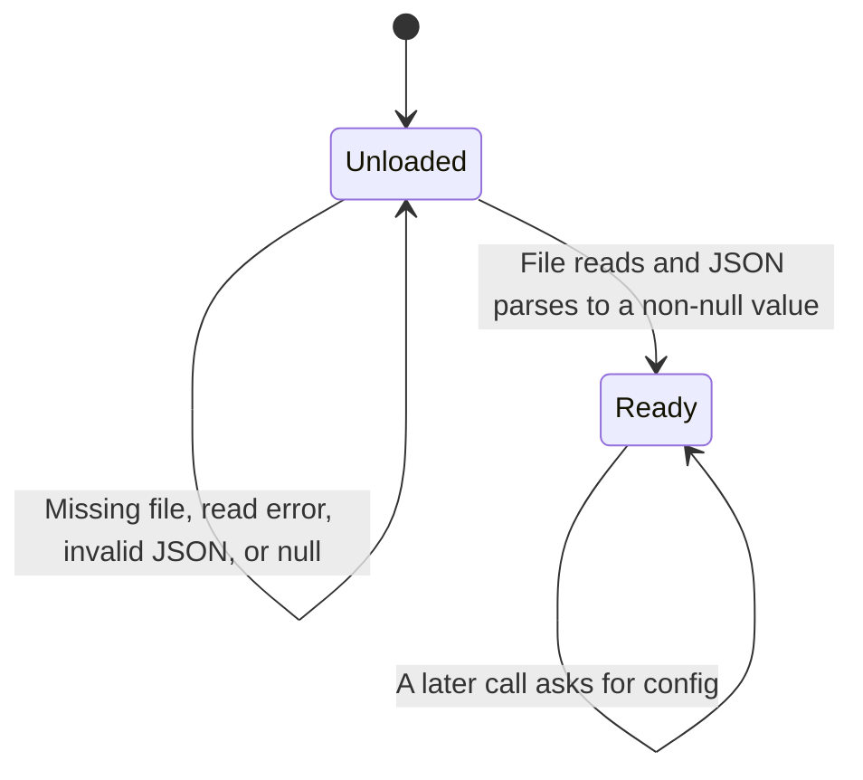

# Session config

Every tool that talks to Skool asks for the same config. The first successful read is kept in memory for the life of the process. A failed read is not remembered, so the next tool call tries the file again.

The path is `homedir()` joined with `.config/skool-mcp/config.json`. That join runs when this module loads, not on each read. This page describes that read. It does not describe whether the cookie is accepted by Skool.

## Nothing cached yet

Until a read succeeds, the module keeps no config. The next call opens the file again. Nothing in this file reads a flag or an environment variable of its own. On POSIX, `homedir()` returns `HOME` when that variable is set, including when it is empty. An empty `HOME` makes the joined path relative. When `HOME` is unset, `homedir()` uses the current user's home directory. `HOME` is seen at module load. Changing it later does not move the path in the running process. No other variable selects a different config path.

## Cookie string is cached

A successful parse stores three fields. When `cookies` or `defaultCommunity` is null or absent, it becomes an empty string. When `baseUrl` is null or absent, it becomes `https://www.skool.com`. A value that is present is kept, including a present empty string, and the code does not coerce it to a string. The code does not check that the cookie string is non-empty. JSON `null` fails this read, because the code then reads fields from the parsed value. Any other JSON value takes the success path and fills missing fields.

After this, the in-memory copy is returned as-is. Editing the file does not change a process that has already read it. Restarting the process is how a new cookie gets in.

The cookie string is sent as the `Cookie` header on the homepage fetch, on Next.js data routes, on `api2.skool.com`, and on the raw fetch. Callers of the raw fetch can pass headers that replace it.

## The read failed

If the file is missing, the thrown message names the path and shows a sample object. In that sample, `cookies` and `defaultCommunity` are the placeholder text `...`, and `baseUrl` is `https://www.skool.com`. Any other failure, including invalid JSON and JSON `null`, throws a message that the config could not be read. The cache stays empty either way.

`skool_notifications` loads configuration before requesting notifications. A missing file throws before the request.

## Later calls skip the disk

Once the cache is set, later calls do not stat the file. A tool that failed halfway through an HTTP call still leaves the config cached. Only a failed load leaves the process unloaded.
