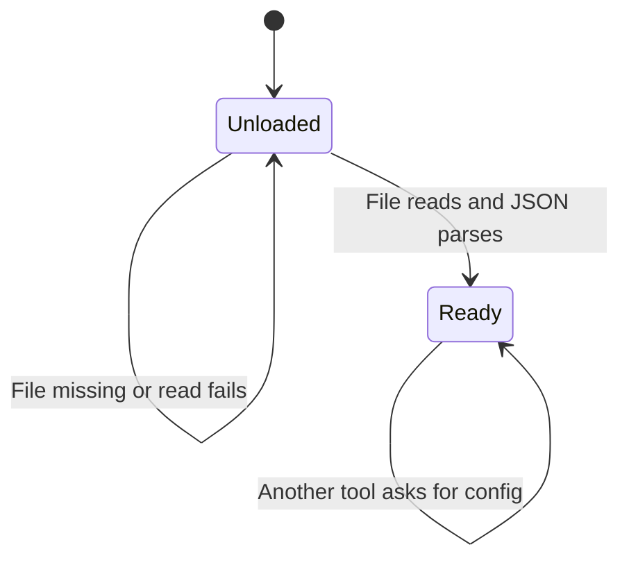

# Session config

Every tool that talks to Skool asks for the same config. The first successful read is kept in memory for the life of the process. A failed read is not remembered, so the next tool call tries the file again.

The file path is the home directory plus `.config/skool-mcp/config.json`. This page describes that read. It does not describe whether the cookie is accepted by Skool.

## Nothing cached yet

Until a read succeeds, the module keeps no config. The next call opens the file again. There is no other source: no environment variable and no flag overrides the path.

## Cookie string is cached

A successful parse stores three strings. Missing fields become empty, except `baseUrl`, which becomes `https://www.skool.com` when it is absent. `cookies` and `defaultCommunity` become empty strings when they are absent. The code does not check that the cookie string is non-empty, and it does not check that the JSON has the expected types beyond what `JSON.parse` already did.

After this, the in-memory copy is returned as-is. Editing the file does not change a process that has already read it. Restarting the process is how a new cookie gets in.

The cookie string is sent as the `Cookie` header on the homepage fetch, on Next.js data routes, on `api2.skool.com`, and on the raw fetch. Callers of the raw fetch can pass headers that replace it.

## The read failed

If the file is missing, the thrown message names the path and shows a sample JSON object with empty placeholder fields. Any other failure, including invalid JSON, throws a message that the config could not be read. The cache stays empty either way.

`skool_notifications` calls this load before its own try/catch. A missing file there still throws. It does not fall through to the HTML page.

## Later calls skip the disk

Once the cache is set, later calls do not stat the file. A tool that failed halfway through an HTTP call still leaves the config cached. Only a failed load leaves the process unloaded.
